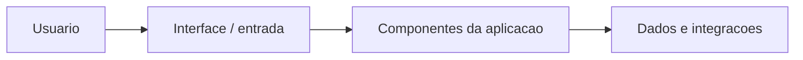

# Arquitetura — foodbridge-Prototipo

Tecnologias: React, TypeScript e Node.js. Referências: client, server, package.json.

Diagrama **conceitual**, não comprova integração em produção. Evitar acoplamento de interface e infraestrutura, documentar contratos e validar dependências antes de executar.

**Riscos:** Trata-se de protótipo UX; telas e dados simulados não representam API completa ou doações reais.
